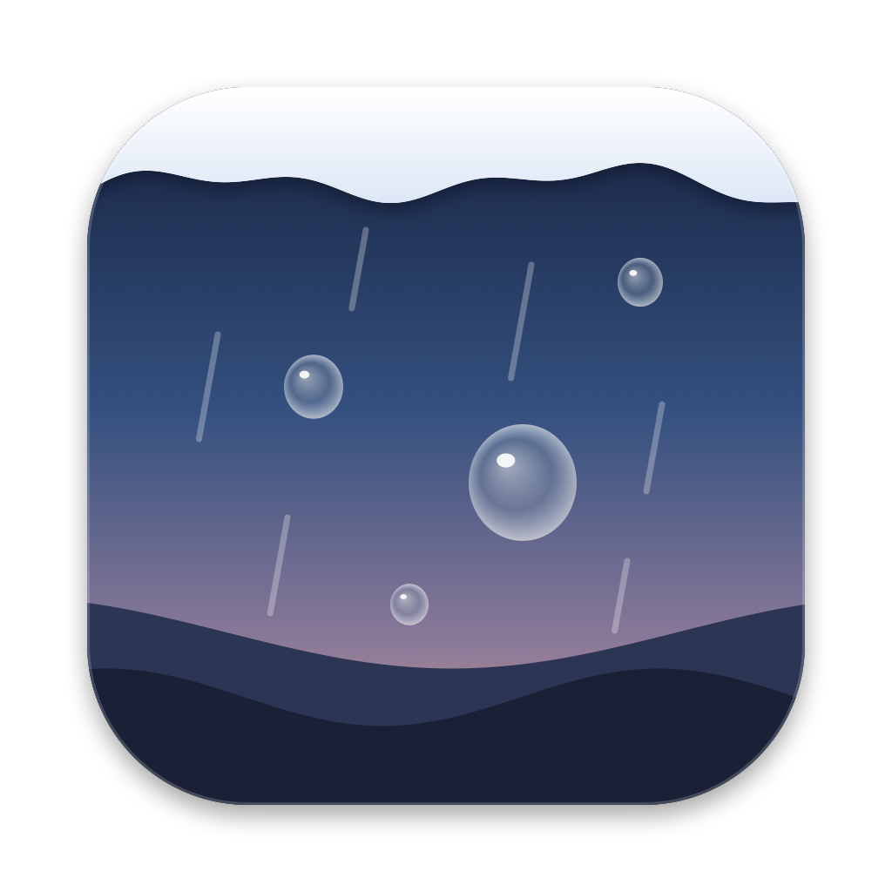
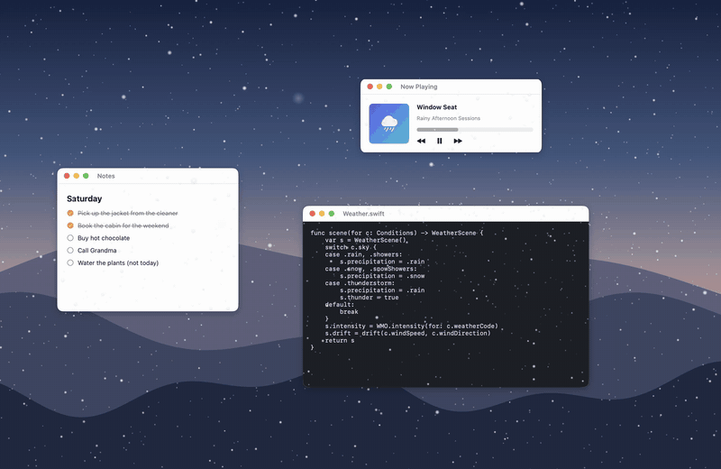
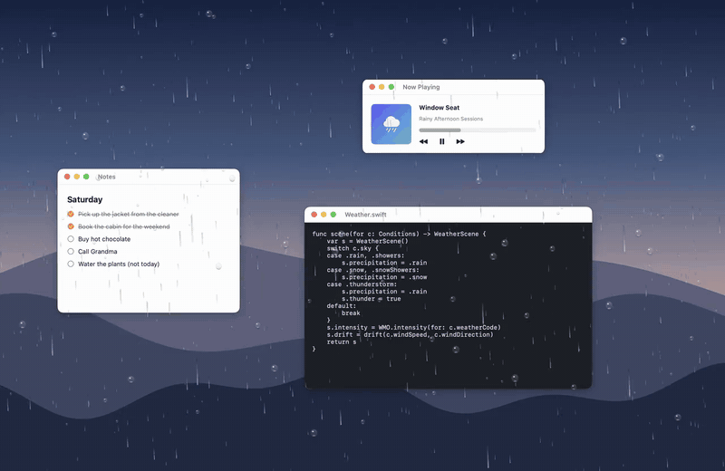

<div align="center">



# Weatherglass

**The weather outside, on your screen.**

When it rains where you are, rain runs down your screen.<br>
When it snows, snow piles up on top of your windows, and falls off when you move them.

[](https://github.com/yangyang1508/weatherglass/actions/workflows/ci.yml)


[](LICENSE)

[**Download**](https://github.com/yangyang1508/weatherglass/releases/latest) · [How it works](#how-it-works) · [Privacy](#privacy) · [FAQ](#faq)



</div>

## What it does

Weatherglass is a tiny menu bar app. It reads the real weather for your town every 15 minutes and shows it on your screen, on top of everything, without getting in your way.

| Weather | What you see |
|---|---|
| ❄️ **Snow** | Flakes at four depths. Snow **settles on the top edge of your windows**. Drag a window, close it or hide it, and its snow falls off. |
| 🌧️ **Rain, drizzle** | Streaks at three depths, and **water beads on the glass** that slide down. Shake the pointer to wipe the glass. |
| ⛈️ **Thunderstorm** | Rain and lightning that lights up the whole screen for a moment. |
| 🌫️ **Fog** | Slow fog that is thicker at the edges and thin in the middle, where you read. |
| 🍂 **Wind** | Leaves blow across the screen. Petals in spring. |
| 🧊 **Hail** | Hailstones and rain. |
| ☀️ **Clear** | Nothing at all. The window hides and uses no power. |

The menu bar shows an icon and the temperature. **Preview** lets you try any weather at any time.



## Install

1. Download **Weatherglass.zip** from the [latest release](https://github.com/yangyang1508/weatherglass/releases/latest) and unzip it.
2. Move **Weatherglass.app** to your Applications folder.
3. Open it. Pick your town, or use your current location.

> [!IMPORTANT]
> Weatherglass is free and is not signed by Apple, so macOS blocks it the first time.
> Open it once, then go to **System Settings → Privacy & Security** and click **Open Anyway**.
> Or run this once in Terminal:
> ```bash
> xattr -dr com.apple.quarantine /Applications/Weatherglass.app
> ```

**Requirements:** macOS 13 Ventura or later. Universal app: Apple silicon and Intel.

### Build from source

You need Xcode (tested with Xcode 26) or the Swift command line tools.

```bash
git clone https://github.com/yangyang1508/weatherglass.git
cd weatherglass
scripts/build-app.sh          # makes dist/Weatherglass.app
open dist/Weatherglass.app
```

With only the command line tools, use `ARCHS=native scripts/build-app.sh`.

## Using it

Click the icon in the menu bar:

- **Show Weather on Screen**: turn it all on or off.
- **Amount**: Subtle, Normal or Cozy.
- **Preview**: rain, thunderstorm, snow, blizzard, drizzle, fog, wind or hail, right now. Choose **Real Weather** to go back.
- **Location**: your current location, or any town you search for.
- **Temperature**: °C or °F, shown in the menu bar or not.
- **Options**:
  - Hide When an App Is Full Screen (on by default)
  - Pause on Battery Power
  - Hide from Screenshots and Screen Sharing
  - Shake the Pointer to Wipe Rain (on by default)
  - Open at Login

Weatherglass never takes a click. Everything you click goes to the window under it.

## Privacy

- **No account, no API key, no analytics, no tracking.**
- Weatherglass sends one kind of request: the forecast for your place, to [Open-Meteo](https://open-meteo.com). Your coordinates are **rounded to 0.1° (about 10 km)** before they leave your Mac. When you search for a town, the search text goes to Open-Meteo's place search.
- If you choose **Current Location**, macOS asks you first. Weatherglass asks for the location once and rounds it.
- Weatherglass reads **where** your windows are, so snow can sit on them. It never reads what is **in** them, and it does not need the Screen Recording permission.

## Performance

Measured on a MacBook Pro (M4 Pro), macOS 26, with the effects on screen:

| | |
|---|---|
| Weatherglass itself | about 1–2.5% of one CPU core, 30–40 MB of memory |
| Drawing (done by macOS in WindowServer) | about 15% of one CPU core more while the effects show |
| Clear weather | close to 0%: the windows hide |

Weatherglass also pauses while your Mac sleeps, while the screen is locked, and while the displays are off. Turn on **Pause on Battery Power** to save battery.

## How it works

```
Open-Meteo forecast ─▶ WeatherScene ─▶ Stage ─▶ one transparent overlay window per display
  (every 15 min)       (rain? how much?    │        fog · rain/snow · snow on windows · glass · leaves · lightning
                        wind? night?)      │
                                           └─▶ WindowTracker (5×/s, only while there is snow)
                                                 ▶ SnowField: how deep the snow is on each window edge
```

- **The overlay** is a borderless, transparent window above all apps that ignores the mouse. All drawing is Core Animation, so macOS's WindowServer does the work, not the app.
- **Rain, drizzle, hail and small snowflakes** are tiles of streaks or flakes that scroll down without a seam, turned to match the wind. Big snowflakes near the "lens" are single layers.
  - Why not `CAEmitterLayer`? We tried it first. On recent macOS, emitter particles that fall as fast as rain are never drawn, and slow snow particles never got lower than about a third of the screen.
- **Snow on windows**: `WindowTracker` reads the frames of on-screen windows with `CGWindowListCopyWindowInfo` (frames only, no content). `SnowField` in `WeatherglassCore` keeps a `SnowCap` for each top edge: a height for every few points of width, only where no other window covers the edge. It grows while it snows, and slides off where it gets too steep. When an edge moves or disappears, its snow becomes falling clumps.
- **`WeatherglassCore`** has no AppKit code: the Open-Meteo client, the mapping from weather codes to a scene, window geometry and the snow model. It has unit tests (`swift test`).

```
Sources/
  WeatherglassCore/   Weather, OpenMeteo, Scene, Snow, Geometry   (tested)
  Weatherglass/       App, Stage, WindowTracker, Location, Demo…
    Effects/          Precipitation, Glass, SnowCaps, Atmosphere, Sprites
scripts/              build-app.sh, record-demo.sh, capture.swift
```

### Try it without real weather

```bash
swift run Weatherglass --preview snow       # rain, storm, snow, blizzard, drizzle, fog, wind, hail
swift run Weatherglass --demo snow          # a made-up desktop with three windows, for recordings
scripts/record-demo.sh snow                 # records docs/media/snow.gif (needs ffmpeg)
```

`--demo` draws its own backdrop and windows, and `record-demo.sh` captures only Weatherglass's windows, so a recording never shows your own screen.

## FAQ

**I can't see the icon in the menu bar.**
A menu bar manager (Bartender, Ice, Thaw) may have put it in its hidden section. On a MacBook with a notch, a full menu bar can also hide it behind the notch.

**Nothing happens.**
That is normal on a clear day: Weatherglass shows only rain, snow, fog, storms, hail and wind. Use **Preview** to see it now. The menu shows the current weather for your place.

**Does it work with several displays?**
It makes one overlay for each display. I have only tested it with one display so far. Reports are welcome.

**Does it slow down games or video?**
It hides when an app is full screen. You can also pause it from the menu.

**Is it on the Mac App Store?**
No. It is free and open source. Get it from [Releases](https://github.com/yangyang1508/weatherglass/releases/latest) or build it yourself.

## Contributing

Ideas, bug reports and pull requests are welcome. See [CONTRIBUTING.md](CONTRIBUTING.md).

## Credits

- Weather data by [Open-Meteo.com](https://open-meteo.com), under [CC BY 4.0](https://creativecommons.org/licenses/by/4.0/).
- All images (flakes, drops, leaves, the icon) are drawn in code. No image files ship with the app.

## License

[MIT](LICENSE)
